# 🕌 Deen — Muslim App

A beautiful **Flutter Islamic App** that helps you stay connected with your faith — showing **accurate prayer times**, **Quran recitation**, **daily duas**, and much more. 🌙

---

## 🌟 Key Features

- 🕋 **Prayer Times:** Accurate times with a countdown to the next prayer and adhan alerts.
- 📖 **Quran:** Read, listen, search, share, and explore Tafsir easily — plus ayah-by-ayah memorization.
- 🌸 **Daily Inspiration:** Verse, Hadith, Name of Allah, and Dua of the day.
- 🤲 **Azkar & Ruqyah:** Morning & evening adhkar, full Ruqyah (text + audio).
- 🔵 **Digital Tasbeeh:** Simple, elegant, and customizable counter.
- 🧭 **Qibla Compass:** Accurate Kaaba direction with bearing and distance to Makkah.
- 🗓️ **Hijri Calendar:** Islamic calendar with sacred days and upcoming occasions.
- 🔒 **Private & Offline:** Everything is calculated and stored on-device — no sign-up, no tracking.

---

## 📥 Download for Android

**[Download the latest Deen APK](https://github.com/JamalMakame/MuslimApp-Flutter/releases/latest)**: open the link on your phone, download `Deen-x.y.z.apk`, open it, and allow installing unknown apps if Android asks. Needs Android 7.0 or newer.

---

## 📱 Screenshots

  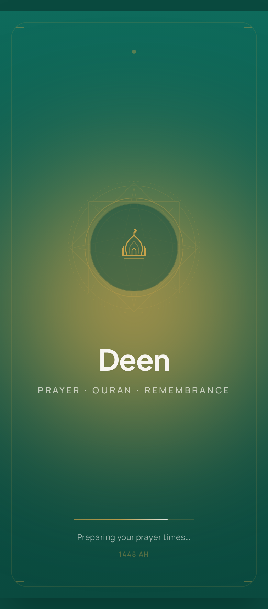
  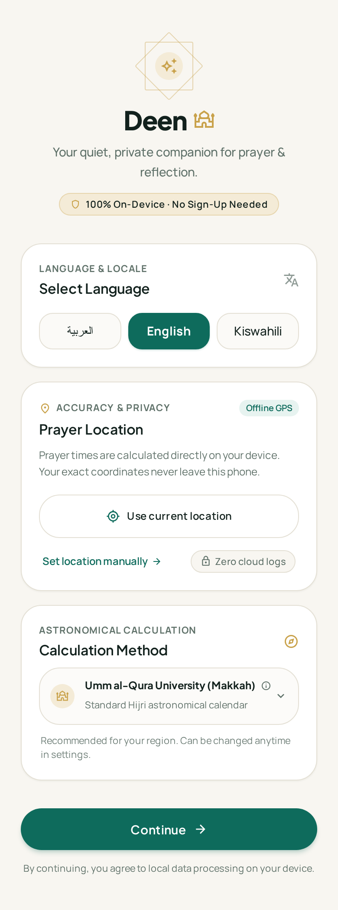
  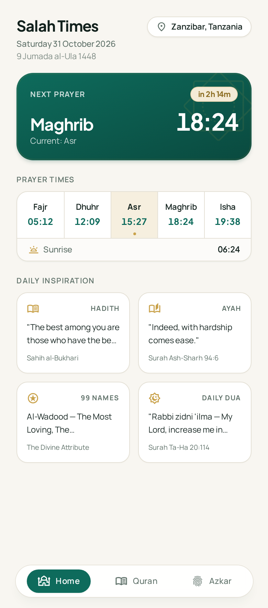
  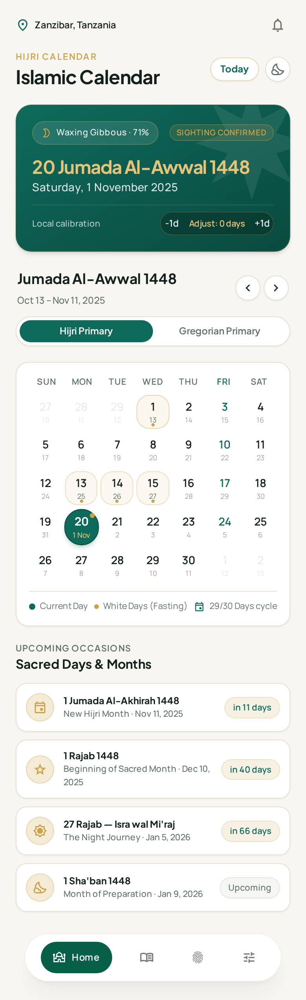

  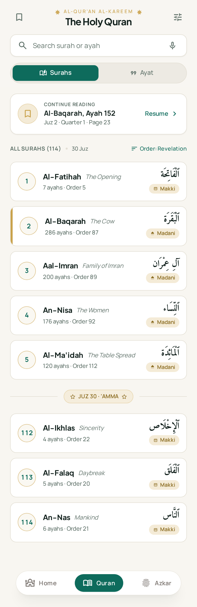
  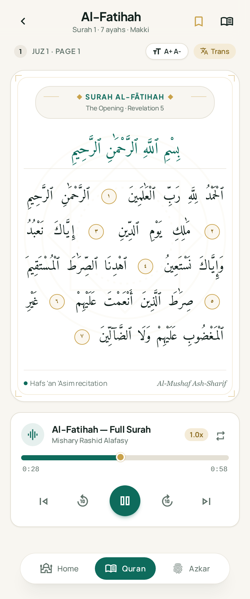
  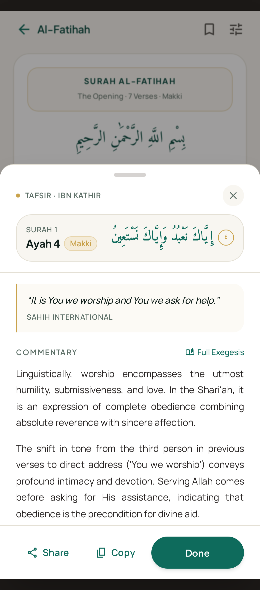
  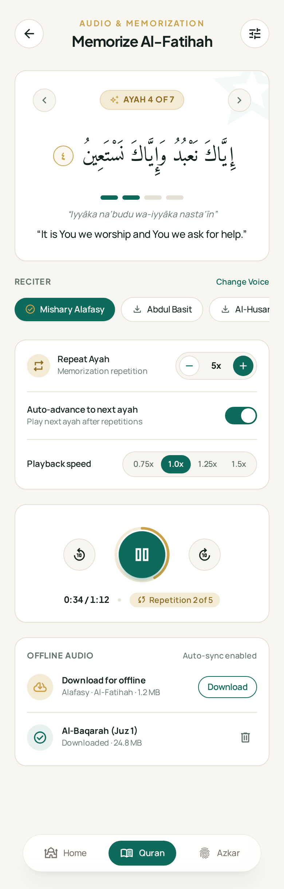

  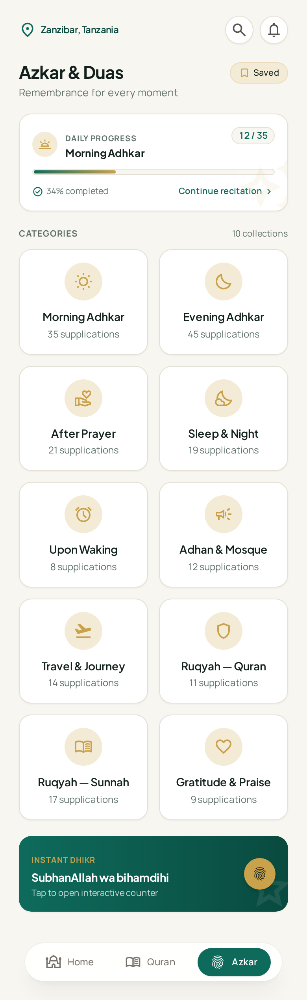
  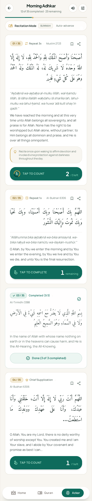
  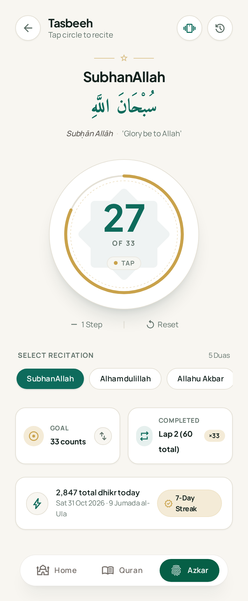
  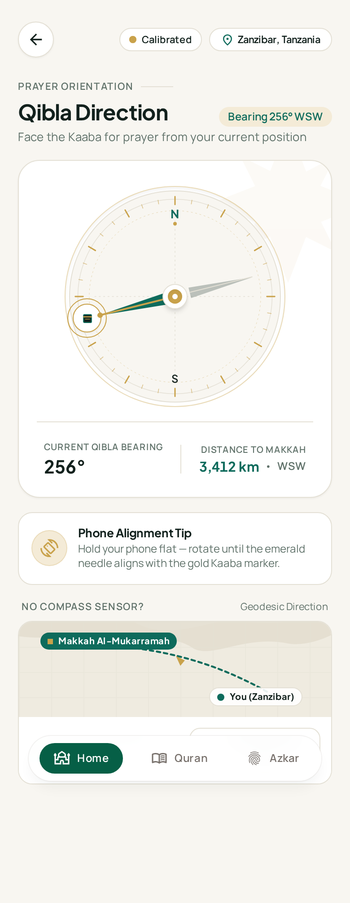

  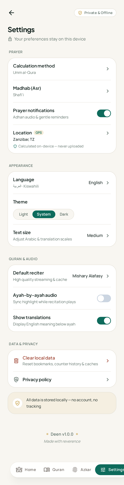

